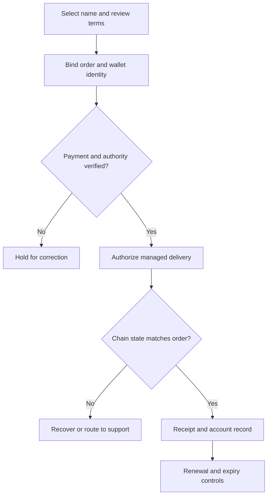

# Architecture and design decisions

[Back to project](../README.md)

The project has two related layers: published educational sites and a managed-naming commerce prototype. They have different release states.

## Published information layer

Nine standalone sites share a visual system and link to a portfolio, inquiry process, research, and resource library. Each site preserves its own canonical URLs, crawl files, and verification files. Deployment checks compare the intended changes with the existing published files and backend configuration.

A normal browser opens the HTTPS site. An ENS URL record can offer an additional discovery route through compatible tooling. It does not authenticate every statement on the destination website.

## Prototype commerce flow

This diagram describes the design and tested prototype behavior. Production purchasing is paused.

## Important implementation decisions

| Decision | Reason |
| --- | --- |
| Bind delivery to the order, recipient, name, terms, and payment evidence. | A valid payment alone must not authorize an unrelated name or recipient. |
| Check state after a transaction. | A submitted transaction is not proof that the expected name, resolver, and records were delivered. |
| Record unique payment and fulfillment identities. | Retries and lost responses must not create duplicate charges or conflicting delivery. |
| Persist order and recovery state. | A restart must not erase the history needed to resume or explain an order. |
| Separate root ownership from delegated management. | Customers and the owner need an accurate explanation of control and revocation. |
| Model expiry explicitly. | A custom managed lease has different behavior from native ENS name ownership. |
| Keep new sales paused until commissioning is complete. | Prototype success does not establish production contract acceptance. |

## Rights and limitations

The prototype explores managed, revocable naming leases. It does not promise an irrevocable right or automatic transfer of an ENS NFT. Root-owner control, resolver behavior, cached results, renewal coverage, cancellation, and migration require clear customer terms.

Independent contract review, deployment/configuration, and hosted end-to-end acceptance remain separate from local integration tests.

## Technologies represented

Node.js, JavaScript, PostgreSQL, Netlify Functions, HTML/CSS, ethers.js, Solidity, typed order records, local EVM fixtures, and automated integration checks.

Public case-study review: November 10, 2026.
